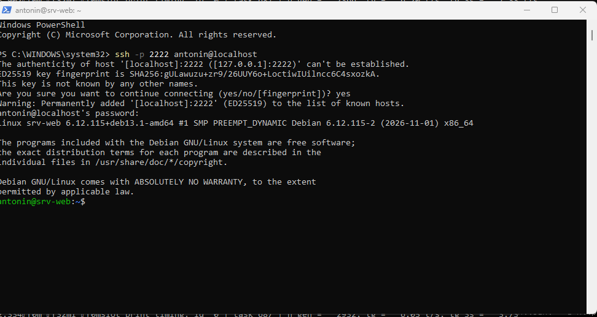
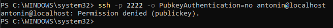
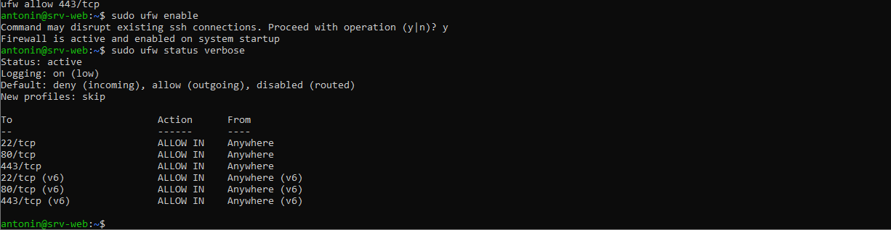
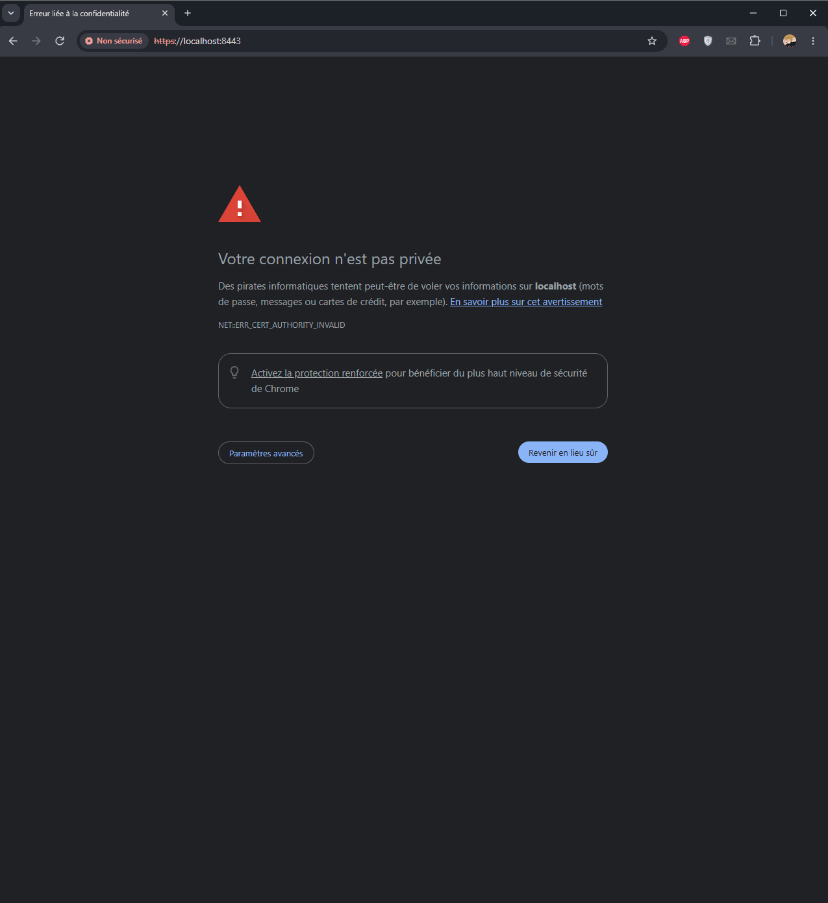
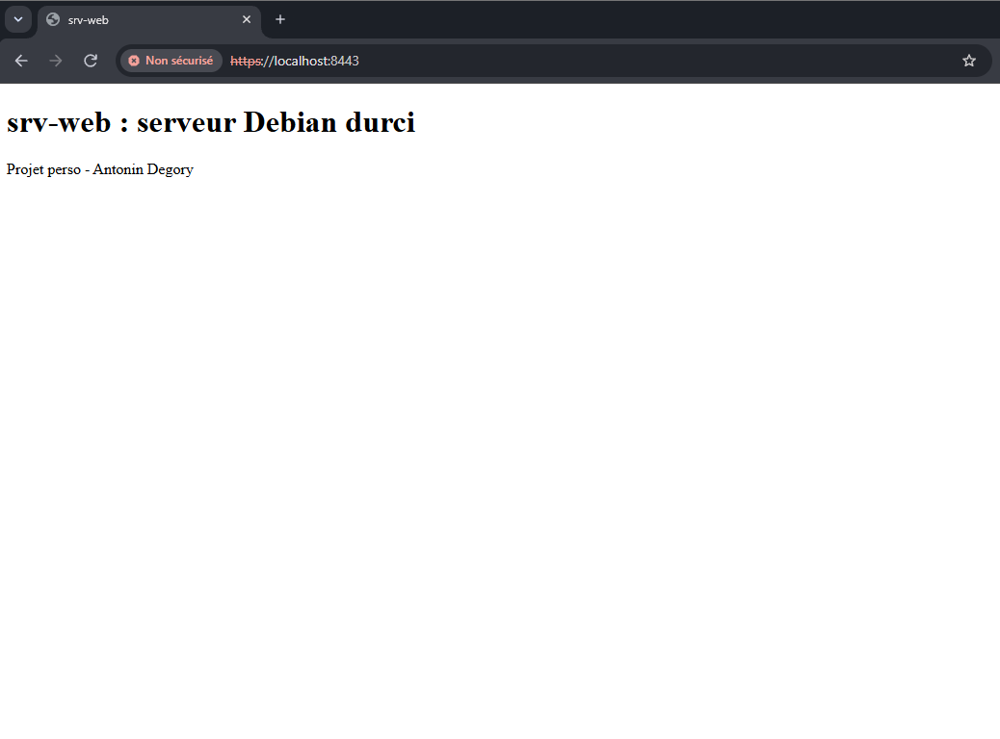
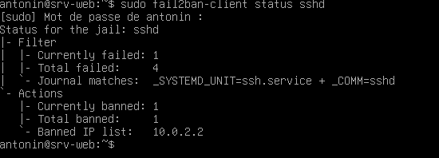

# srv-web : serveur web Debian durci

Projet personnel : installation et sécurisation d'un serveur web Linux dans une machine virtuelle.
Le serveur n'accepte que les connexions par clé SSH, filtre les ports avec un pare-feu, sert un site
en HTTPS et bannit automatiquement les adresses qui tentent de deviner un accès.

Réalisé par Antonin Degory, BTS SIO option SISR 1A (2026-2028), ENSITECH Saint-Quentin-en-Yvelines, novembre 2026.

## Pourquoi ce projet

Dans l'atelier [Vigie](https://github.com/antonindgr/vigie-bergerat-tournier), j'ai écrit un outil qui
**détecte** les attaques par force brute dans un journal SSH. Ici, je vais plus loin : je monte un serveur
qui **bloque** ces attaques tout seul, et qui réduit au maximum ce qu'un attaquant peut tenter.

## Environnement

| Élément | Choix |
|---|---|
| Hôte | PC Windows, VirtualBox |
| Serveur | Debian 13 « Trixie », sans interface graphique |
| Réseau | NAT VirtualBox avec redirection de ports : 2222 → 22 (SSH), 8080 → 80 (HTTP), 8443 → 443 (HTTPS) |
| Administration | SSH depuis PowerShell |
| Services | OpenSSH, UFW, Nginx, OpenSSL, Fail2ban |

## Ce que j'ai mis en place

| Étape | Ce que j'ai fait | Fichier |
|---|---|---|
| 1. Installation | Debian 13 sans bureau : seulement le serveur SSH et les utilitaires système. Moins de logiciels installés, c'est moins de failles possibles. | |
| 2. SSH | Connexion par clé ed25519. Mots de passe, connexion root et autres comptes interdits, 3 essais maximum. | [`config/ssh/99-durcissement.conf`](config/ssh/99-durcissement.conf) |
| 3. Pare-feu | UFW : tout ce qui entre est bloqué par défaut, sauf les ports 22, 80 et 443. | [`config/ufw/regles.txt`](config/ufw/regles.txt) |
| 4. Web | Nginx sert ma page en HTTPS (TLS 1.2 et 1.3 uniquement). Le HTTP est redirigé vers le HTTPS et la version de Nginx est cachée. | [`config/nginx/default`](config/nginx/default) |
| 5. Fail2ban | Une adresse qui rate 3 connexions SSH en 10 minutes est bannie pendant 1 heure. | [`config/fail2ban/jail.local`](config/fail2ban/jail.local) |

## Captures

| Preuve | Capture |
|---|---|
| Connexion au serveur depuis PowerShell |  |
| Mot de passe refusé : seule la clé est acceptée |  |
| Pare-feu actif |  |
| Avertissement du certificat auto-signé |  |
| Page servie en HTTPS |  |
| Attaque bloquée par Fail2ban |  |

## Tests effectués

| Test | Commande | Résultat |
|---|---|---|
| Connexion avec la clé | `ssh -p 2222 antonin@localhost` | Connexion sans mot de passe de compte |
| Connexion sans la clé | `ssh -p 2222 -o PubkeyAuthentication=no antonin@localhost` | `Permission denied (publickey)` |
| Pare-feu | `sudo ufw status verbose` | `deny (incoming)`, seuls 22, 80 et 443 sont autorisés |
| Redirection HTTP | `http://localhost:8080` dans le navigateur | Renvoi automatique vers `https://localhost:8443` |
| Attaque par force brute | `ssh -p 2222 pirate@localhost` lancé plusieurs fois | 4 échecs, puis `10.0.2.2` banni : ma session SSH ouverte est coupée |
| Débannissement | `sudo fail2ban-client set sshd unbanip 10.0.2.2` | Je peux me reconnecter |

`10.0.2.2` est l'adresse sous laquelle la VM voit mon PC à travers le NAT de VirtualBox.

## Difficultés rencontrées

| Difficulté | Comment je l'ai résolue |
|---|---|
| À l'installation, appuyer sur Entrée à « Appliquer les changements sur les disques ? » annulait le partitionnement (le choix par défaut est Non). | J'ai compris que l'installateur en mode texte prend l'option marquée `[*]` par défaut, et j'ai tapé le numéro de l'option voulue. |
| Le copier-coller ne marchait pas dans la session SSH : Ctrl+V envoyait un caractère spécial au serveur. | J'ai tapé les fichiers de configuration avec l'éditeur `nano`. Dans une session SSH sous PowerShell, on colle avec un clic droit. |
| J'ai autorisé le port 55 dans le pare-feu par erreur. | Je l'ai repéré avec `sudo ufw show added`, puis supprimé avec `sudo ufw delete allow 55/tcp` avant d'activer le pare-feu. |
| Fail2ban refusait de démarrer. | Le journal (`systemctl status fail2ban`) indiquait la ligne 3 de `jail.local` : j'avais oublié le `=` dans `backend = systemd`. |
| Une faute de frappe (`nging` au lieu de `nginx`) ouvrait un fichier vide. | Le message de nano indiquait que le dossier n'existait pas : j'ai quitté sans enregistrer et corrigé le chemin. |

## Choix de sécurité

- **Moindre privilège** : le pare-feu bloque tout par défaut, et seul mon compte peut se connecter en SSH.
- **Autoriser le port 22 avant d'activer UFW** : dans l'autre ordre, le pare-feu coupe sa propre connexion d'administration.
- **Fichiers séparés** (`sshd_config.d/99-durcissement.conf`, `jail.local`) plutôt que de modifier les fichiers d'origine : mes réglages sont faciles à retrouver, à expliquer, et ne sont pas écrasés par les mises à jour.
- **Tester avant d'appliquer** : `sshd -t` et `nginx -t` vérifient la configuration avant le rechargement du service.
- **Garder un accès de secours** : la console VirtualBox m'a permis de me débannir après le test de Fail2ban.

## Limites et améliorations

- Le certificat est **auto-signé** : la connexion est chiffrée, mais le navigateur affiche un avertissement. Sur un vrai serveur public, j'utiliserais **Let's Encrypt** avec un nom de domaine.
- La redirection HTTP vers HTTPS vise le port 8443, à cause de la redirection de ports de VirtualBox. Sur un vrai serveur, elle viserait le port 443.
- Pistes pour la suite : mises à jour de sécurité automatiques (`unattended-upgrades`), en-têtes de sécurité HTTP, supervision des journaux.

## Ce que j'ai appris

J'ai appris à administrer un serveur Linux uniquement en ligne de commande, à distance, depuis PowerShell.
J'ai compris qu'on sécurise un serveur par couches : chacune (clé SSH, pare-feu, HTTPS, Fail2ban) bloque
ce que les autres laissent passer. J'ai aussi appris à lire les journaux d'un service pour trouver une erreur,
et à toujours garder un accès de secours avant de changer une règle qui peut me bloquer dehors.

## Compétences du référentiel (bloc 1)

- **C1 Gérer le patrimoine informatique** : installer et configurer un serveur, documenter sa configuration.
- **C2 Répondre aux incidents** : diagnostiquer un service qui ne démarre pas grâce à ses journaux, réagir à une attaque simulée.
- **C5 Mettre à disposition des utilisateurs un service informatique** : un site web accessible en HTTPS.
- **C6 Organiser son développement professionnel** : projet personnel publié sur GitHub dans mon portfolio.

## Ce qui n'est pas dans ce dépôt

Aucune clé privée (`id_ed25519`, `srv-web.key`) ni aucun mot de passe : ils ne doivent jamais être publiés.
